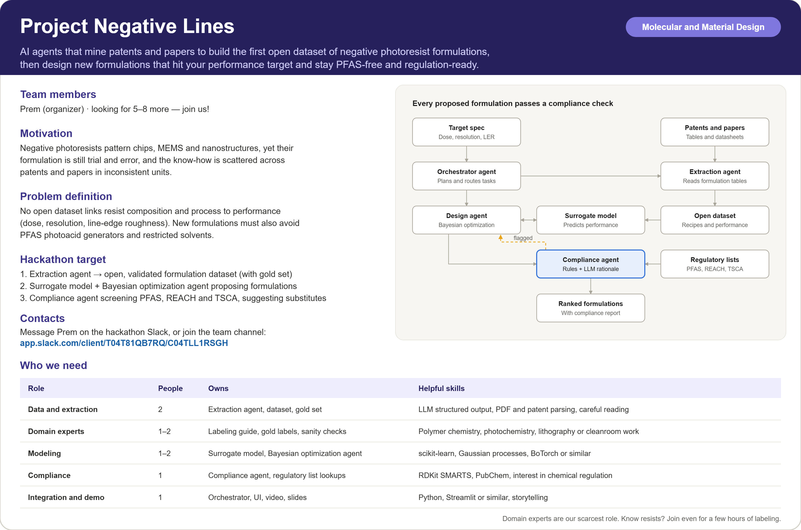

# Project Negative Lines

AI agents that mine patents and papers to build the first open dataset of negative photoresist formulations, then design new formulations that hit a performance target and stay PFAS-free and regulation-ready.

Built at the [OSI Hackathon](https://llmhackathon.github.io/) (October 21–22, 2026) in the **Molecular and Material Design** track.



## Why

Negative photoresists pattern semiconductor chips, MEMS, microfluidics and nanostructures. Their formulation is still largely trial and error:

- **No open data.** Recipes (resin, crosslinker, photoacid generator, quencher, solvent) and their lithographic performance are scattered across patents and papers in inconsistent units.
- **Costly iteration.** Sensitivity, resolution and line-edge roughness trade off against each other, and every iteration costs coating, exposure and SEM time.
- **Regulatory pressure.** Many photoacid generators use PFAS anions, and some common solvents are restricted. New formulations have to perform *and* comply.

## What we are building

| Component | What it does |
| --- | --- |
| Extraction agent | Reads formulation tables in patents, papers and datasheets and turns them into structured, cited records |
| Open dataset | Composition + process + performance records in a shared schema ([`vocab.yaml`](vocab.yaml)) |
| Surrogate model | Predicts performance (dose, resolution, LER) from formulation and process |
| Design agent | Bayesian optimization over formulations, guided by the surrogate, toward a target spec |
| Compliance agent | Screens candidates against PFAS, REACH and TSCA lists, explains flags and suggests substitutes |
| Orchestrator | Takes the target spec, coordinates the agents and assembles the ranked report |

Every candidate from the design agent passes through the compliance agent. Flagged candidates are rejected or penalized, so only compliant formulations reach the ranked output.

## Hackathon deliverables

- [ ] Open formulation dataset: 50–200 records in the agreed schema
- [ ] Gold set of ~10 hand-labeled documents and an extraction accuracy report (precision and recall on held-out documents)
- [ ] Extraction agent with page and table citations (working end to end, accuracy not yet validated; see [Status](#status-and-known-limitations))
- [ ] Surrogate model + Bayesian optimization design agent
- [ ] Compliance agent with cited rationale and substitutes
- [ ] End-to-end demo, video and slides

---

## Extraction agent

The extraction agent turns a patent into records that follow [`vocab.yaml`](vocab.yaml): one
record per formulation processed one way, with its components, process conditions and results,
and a source reference (block ID and verbatim quote) for every value.

### Quick start

Requires Python 3.11+ and an API key for an LLM provider (OpenAI or Google Gemini today).

```bash
pip install uv                 # once, if you do not have uv
cd negative-lines
uv sync                        # creates .venv and installs everything
cp .env.example .env           # Windows PowerShell: Copy-Item .env.example .env
#   then edit .env: set NL_LLM_PROFILE and the API key of that profile (never commit .env)

uv run pytest                  # offline tests, no API calls (should all pass)
uv run negative-lines ingest   US20080241753A1                 # fetch + parse, no LLM, free
uv run negative-lines examples US20080241753A1                 # 1 LLM call: list the examples
uv run negative-lines extract  US20080241753A1 -e "Example 3"  # extract one example
```

The last command prints a summary and writes the results to
`data/extracted/US20080241753A1/<UTC time>_<profile>/`.

### How it works

```
Google Patents page ──ingest──> SourceDocument: citable blocks (p-0158, t-2-r-7-8, c-1 ...)
        │                       raw HTML cached in data/raw/ (gitignored)
        ▼
 1 LLM call: DocumentMap          lists examples, tables, codename definitions,
        │                         shared conditions, grade legends (whole document)
        ▼
 per example: context assembly    only the blocks relevant to this example (no LLM)
        ▼
 1 LLM call: ExampleExtraction    structured output; validated against the labeling-guide
        │                         rules; on failure 1 repair retry with the error list
        ▼
 checks (no LLM)                  quote verification + consistency checks -> warnings
        ▼
 enrich (no LLM)                  record IDs, unit conversion, wt% of solids,
        │                         dose = intensity x time, provenance
        ▼
 FormulationRecord (vocab v3) ──> data/extracted/<doc_id>/<run_id>/records.jsonl
```

1. **Ingest** (`negative_lines.ingest.google_patents`). Downloads the Google Patents page and
   splits it into blocks with stable IDs: paragraphs `p-0041` (printed paragraph number),
   headings `h-0007`, list items `li-0055`, table rows `t-1-r-3`, claims `c-1`. Patent tables
   often wrap one row over several printed lines; these are merged into one logical row
   `t-1-r-7-9` ("Table 1, rows 7-9") and the model sees the merged row
   (`negative_lines.ingest.tables`). Claims are not sent to the model.
2. **Document map**. One call over the whole document lists the examples and the information
   shared between them.
3. **Per-example context** (`negative_lines.extract.context`). Each example call sees only:
   - **A** its own section text (e.g. under "Examples 3 to 24 and Comparative Example 1"),
   - **B** its table rows, with table captions and header rows,
   - **C** other paragraphs that name it ("In Examples 3, 5 and 7 ..."),
   - **D** the procedure of any example it explicitly refers to ("the same method as that used
     in Example 1"), marked as *inherited*: used for process steps only, never for its amounts,
     thicknesses or results,
   - **E** definitions of its ingredients and codenames (e.g. "PAG1 denotes ...", synthesis
     examples), and **F** conditions shared by several examples.

   For US20080241753A1 Example 3 this is about 8k instead of 65k characters. If nothing can be
   located for an example, the whole document is used and a warning is recorded.
4. **Extraction**. Provider-native structured output with our JSON schema
   (`negative_lines.schema.llm`). The answer is validated in our code against the labeling-guide
   rules (`negative_lines.schema.validators`); if it breaks a rule, the errors are sent back once
   for repair. Targeted rules (roles, amount bases, mixed solvents, exposure sources, record
   boundaries, verbatim quotes) are in `negative_lines.extract.rules`.
5. **Record boundaries**. One record per formulation processed one way. If an example reports
   distinct experimental conditions with results for each (e.g. resist thickness "100/200"),
   one record per condition is created (`variant_label`, e.g. `..._ex3_film-100-nm`).
6. **Checks** (warnings, values are never changed):
   - *quote verification*: every quote must occur in the block it cites,
   - *consistency*: e.g. e-beam tool with a non-e-beam source, amine not marked as quencher,
     "parts by weight" with resin 100 not marked `parts_per_100_resin`, resist thickness equal
     to the underlayer thickness, unsplit mixed solvent,
   - *labeling-guide soft rules*: e.g. values of 0, e-beam without kV, possible variants not split.
7. **Enrichment** (`negative_lines.enrich`). Builds the dataset record: record ID
   `<doc_id>_<example>[_<variant>]`, nm/s conversion, `amount_wt_pct_solids`, `dose_computed`,
   provenance (model, prompt version, first cited location).

LLM responses are cached in `data/cache/` (gitignored), keyed by model, prompt version, schema
and input: re-running the same extraction costs nothing.

### Using it

#### Command line

```bash
uv run negative-lines ingest   <doc_id> [--blocks N] [--json out.json]   # parse only, free
uv run negative-lines examples <doc_id>                                  # list example labels
uv run negative-lines extract  <doc_id> -e "Example 3" -e "Comparative Example 1"
uv run negative-lines extract  <doc_id>                                  # all examples
```

`<doc_id>` is a Google Patents publication number such as `US20080241753A1`. Example labels
must be written as `negative-lines examples` lists them.

| Option | Meaning |
| --- | --- |
| `--profile <name>` | LLM profile from `config/llm.yaml` (default: `NL_LLM_PROFILE` in `.env`) |
| `--max-examples N` | refuse to run if more than N examples would be extracted |
| `--no-cache` | ignore cached responses (makes new paid calls) |
| `--no-write` | do not write output files |
| `--print-records` | print the records as JSON |
| `--out-dir <dir>` | write somewhere other than `data/extracted/` |
| `--allow-benchmark` | permit reserved benchmark documents (approved milestone runs only) |

Exit codes: `0` all examples valid, `1` some examples still invalid after the repair retry,
`2` refused (benchmark document, missing API key, too many examples).

#### From Python

```python
from negative_lines.extract.api import extract_patent, list_examples

list_examples("US20080241753A1")          # [("Example 1", False), ...]
run = extract_patent("US20080241753A1", examples=["Example 3"], profile="openai_mini")

for rec in run.records:                   # list[FormulationRecord]
    print(rec.record_id, [c.name_as_written for c in rec.components], rec.warnings)
run.failures                              # examples still invalid, with errors and raw output
run.usage()                               # billed and cached tokens
run.paths                                 # files written (out_dir=None writes nothing)
```

Reading saved records:

```python
from negative_lines.schema.record import FormulationRecord

path = "data/extracted/US20080241753A1/<run_id>/records.jsonl"
records = [FormulationRecord.model_validate_json(line) for line in open(path, encoding="utf-8")]
```

#### Output files

Each run writes `data/extracted/<doc_id>/<UTC time>_<profile>/`:

| File | Content |
| --- | --- |
| `records.jsonl` | one `FormulationRecord` per line (vocab v3 field names) |
| `run.json` | model, prompt and vocab versions, examples requested, token usage, per-example validation attempts and repair errors, quote-verification counts, context summary (inherited examples, variant hints), warnings |
| `document_map.json` | the document map |
| `failures.json` | errors and raw output of examples that stayed invalid |

#### Reading a record

- **Values are copied as printed** (`amount_raw`, `amount_unit`, temperatures, times); code adds
  normalized fields (`amount_wt_pct_solids`, `exposure_time_s`, `pitch_nm`, ...). Missing
  values are `null`, never 0.
- **Every component, result and process group has `refs`**: `block_id` (look it up with
  `negative-lines ingest <doc_id> --json doc.json`), `location` (e.g. "Table 2, rows 7-8"),
  `quote` and `purpose` (`value`, `codename_definition`, `shared_condition`,
  `inherited_condition`, `grade_scale`).
- **`labeler_confidence` / `labeler_note`** on records, components and results are the model's
  own confidence and notes.
- **`warnings`** list everything a reviewer should check: unverified quotes, consistency
  problems, possible variants not split, missing units. A record with warnings is still
  written; review before using it in the dataset.

#### Choosing the model

Profiles are in `config/llm.yaml` (`openai_mini` = `gpt-4o-mini`, `gemini_flash`,
`gemini_flash_lite`). Select one with `NL_LLM_PROFILE` in `.env` or `--profile`. To try another
model, add a profile (provider, model, API-key variable, temperature, structured-output method);
no code changes are needed. Other providers need their LangChain package, e.g.
`uv add langchain-anthropic`.

#### Costs

One document-map call per document plus one call per example (plus at most one repair each).
With `gpt-4o-mini`, US20080241753A1 Example 3 used about 43k input and 10k output tokens in
total (about $0.01). Without `-e`, every example in the document is extracted; run
`negative-lines examples <doc_id>` first to see how many there are. Repeated runs with the same
prompt version come from the cache.

#### Which documents may be extracted

Documents are checked against [`eval/split.yaml`](eval/split.yaml):

- **development** gold documents and **patents outside the gold set**: freely;
- **benchmark** gold documents: refused unless `--allow-benchmark` is given for an approved
  milestone run. Please do not tune prompts or rules on benchmark patents.

### Status and known limitations

The pipeline works end to end (ingest -> map -> per-example extraction -> validation and repair
-> checks -> enrichment -> files). **Accuracy is not yet validated**: so far it has been run on
one example (US20080241753A1, Example 3) and compared by hand with development gold v0.

Latest result for that example (`gpt-4o-mini`, prompt `2026-10-23.1`): both records of the
100 nm / 200 nm variants found; per record, components 18/28 fields, process 11/13, results
10/12 agree with gold; 26/34 quotes verified in their cited block.

Known open issues (most are flagged in `warnings`):

- amount basis: "parts by weight" with resin 100 still often returned as `parts_by_mass`
  instead of `parts_per_100_resin` (flagged by a consistency warning);
- mixed solvents ("PM/PE = 3/7") not always split into two components;
- some process steps missed (softbake from a table cell, hard bake as "dried with heating");
- qualitative results stated in running text (e.g. "thickness loss did not occur") missed;
- some quotes paraphrased or attributed to the wrong block (flagged by quote verification);
- every example call currently needs one repair (amount value and text both filled);
- input is Google Patents HTML only; PDF input (needed for patents whose tables are images)
  is not implemented;
- no automatic scorer yet; precision/recall against gold is the next step.

#### Extraction rules awaiting team confirmation

Rules in `negative_lines/extract/rules.py` are tagged `vocab`, `guide`, `schema` or
`assumption`. These are assumptions and need confirmation:

| Rule | Assumption |
| --- | --- |
| `role-nitrogen-compound` | a component class "nitrogen-containing (organic) compound" is a quencher |
| `role-carboxylic-acid` | an organic carboxylic acid minor component (e.g. salicylic acid) is an additive |
| `exposure-mode-writer` | an electron-beam writer means mode `ebeam_direct_write` |
| `post-development-drying` | "dried with heating at X °C for Y s" after development is the hard bake |
| `inherited-conditions` | "same method as Example N" supplies process steps only; thicknesses, solids, amounts and results of Example N are not inherited |
| `table-row-wins` | if the example's table row and inherited text disagree, the table row is used (gold QC "Team Rule X-1") |

Other provisional choices (in `negative_lines/enrich/convert.py` and `enrich/ids.py`): the
record-ID convention (`ex3`, `cex1`), merging per-bake methods into one `bake_method`,
`provenance.location` from the first cited value, `provenance.confidence` left empty.

---

## Development

### Tests

```bash
uv run pytest                  # offline and deterministic (fake LLM, synthetic fixtures)
uv run pytest -m network -rP   # opt-in: downloads a development patent from Google Patents
uv run pytest -m live -rP      # opt-in, PAID: real provider calls on synthetic input
uv run ruff check . && uv run ruff format --check .
```

Tests check, among other things, that the Python schema matches `vocab.yaml`, that the LLM
schemas satisfy strict structured-output rules, the labeling-guide validators, ingestion against
a synthetic Google Patents page, per-example context assembly, and that no benchmark document
appears in prompts or fixtures.

### Changing things

- **Vocabulary / schema:** edit `vocab.yaml` (one owner, bump `version`), then update
  `schema/enums.py`, `schema/record.py`, `schema/llm.py` and `schema/mapping.py`; the
  consistency tests show what is out of sync.
- **Prompts or rules:** edit `extract/prompts.py` or `extract/rules.py` and bump
  `PROMPT_VERSION` (it is part of the cache key and recorded with every run). Tag new rules with
  their basis; assumptions must be listed in this README (a test checks it).
- **New checks:** soft checks go into `schema/validators.py` (`collect_warnings` /
  `consistency_warnings`); hard rules (which trigger a repair) into the model validators.

### Repository layout

```
.
├── README.md
├── vocab.yaml                 # controlled vocabulary and record schema (v3), source of truth
├── pyproject.toml / uv.lock   # Python project (uv)
├── .env.example               # copy to .env (gitignored) for API keys
├── config/llm.yaml            # LLM provider/model profiles (no secrets)
├── src/negative_lines/
│   ├── config.py              # settings, LLM profile loading, API-key checks
│   ├── vocab.py               # vocab.yaml loader (units, dose families, record fields)
│   ├── cli.py                 # `negative-lines` command (ingest | examples | extract)
│   ├── schema/
│   │   ├── enums.py           # static Literal mirrors of vocab.yaml
│   │   ├── refs.py            # SourceRef (block ID, location, quote, purpose)
│   │   ├── llm.py             # LLM structured-output models (DocumentMap, ExampleExtraction)
│   │   ├── record.py          # full dataset record (FormulationRecord)
│   │   ├── mapping.py         # vocab <-> LLM <-> record field mapping
│   │   └── validators.py      # labeling-guide rules and consistency checks
│   ├── ingest/                # Google Patents parser, blocks, wrapped-row merging
│   ├── llm/                   # chat-model factory; validated structured calls (repair, cache)
│   ├── extract/               # prompts, rules, labels, per-example context, quote
│   │                          #   verification, pipeline, api.extract_patent()
│   ├── enrich/                # record IDs, units, wt% of solids, LLM -> dataset record
│   └── gold/                  # split loader, workbook subsetting, gold v0 adapter + vocab mapping
├── eval/
│   ├── split.yaml             # AUTHORITATIVE development/benchmark split
│   └── gold_versions.yaml     # gold versions, checksums, known issues
├── data/
│   ├── gold/v0/               # development.xlsx (development documents only) + meta
│   ├── extracted/             # extraction runs (records.jsonl, run.json, ...)
│   ├── raw/                   # downloaded source pages (gitignored)
│   └── cache/                 # LLM response cache (gitignored)
├── tests/                     # offline tests; fixtures/ingest (synthetic Google Patents page)
└── docs/
    ├── hand-labeling-guide.md
    ├── negative-lines-card.png
    └── negative-lines-card.svg
```

---

## Gold set and evaluation split

**Gold v0 is provisional.** It contains the team's human annotations, machine-aligned with a
single-pass AI extraction, and reconciled. Reconciliation continues in team meetings,
so labels may still change; every score must state the gold version it was computed against
([`eval/gold_versions.yaml`](eval/gold_versions.yaml), which also records the SHA-256 of the
original full workbook and its known issues).

The split is by **document**, never by record. [`eval/split.yaml`](eval/split.yaml) is the
**authoritative** definition; the tables below describe split version 1 and must be updated
together with it (a test checks that every document in `split.yaml` is listed here).

Load the development gold in Python:

```python
from negative_lines.gold.adapter import load_development_gold

gold = load_development_gold()            # 127 records of the 4 development patents
rec = gold.get("US20080241753A1_ex3_100nm")
rec.record                                # FormulationRecord (vocab v3)
rec.original, rec.flags                   # original spreadsheet rows, v0 -> v3 mapping flags
```

### Development set (4 patents, 127 records)

Stored in `data/gold/v0/development.xlsx` (derived from the full workbook; only these documents).

| No. | doc_id | Records | Real extraction | Notes |
| --- | --- | --- | --- | --- |
| 01 | US20210018838A1 | 6 | Google Patents HTML | coating only (thickness, uniformity) |
| 02 | WO2004107052A1 | 51 | postponed (needs PDF) | coating quality; HTML tables are images |
| 03 | CN120370628A | 21 | postponed (needs PDF) | Tables 1-2 missing in source; 19 low-confidence records |
| 06 | US20080241753A1 | 49 | Google Patents HTML | e-beam 70 kV; **first real extraction test** |

Allowed uses: prompt development, worked examples in prompts (at most 2, chosen from these
documents only), debugging, integration tests, development evaluation and record-level error
analysis.

### Benchmark set (6 patents, 112 records): reserved

| No. | doc_id | Records | Notes |
| --- | --- | --- | --- |
| 04 | US20020068237A1 | 6 | visible light (>= 480 nm) |
| 05 | KR20240036456A | 8 | Korean, Google Patents translation |
| 07 | US7432034B2 | 17 | e-beam 50 kV and X-ray; granted patent |
| 08 | US9017923B2 | 16 | e-beam 50 kV; dry-etch tests |
| 09 | US20230314945A1 | 19 | EUV 13.5 nm |
| 10 | US20070248896A1 | 46 | SU-8 thick film; adhesion, via cracking, wafer bow |

Allowed use: milestone evaluation only, reported as aggregates. Benchmark annotations are kept
**outside this repository and the agent working directory**; they must not be used for prompts,
worked examples, skills, test fixtures, debugging or value-level error analysis. The gold
loader refuses benchmark documents unless called with `allow_sets=("benchmark",)`, and the
scorer reads them only from `NL_GOLD_BENCHMARK_PATH` for an approved run.

### Exclusions and subsets

- **Low confidence:** records with `labeler_confidence = low` (currently 19 of the 21
  CN120370628A records; only `CN120370628A_ex21` (W1, high) and `CN120370628A_cex9` (medium)
  are not low) are kept and identifiable (`GoldRecord.low_confidence`) and are scored as a
  separate tier, excluded from headline numbers.
- **Postponed extraction:** WO2004107052A1 and CN120370628A are not extracted until PDF
  ingestion exists; their annotations remain available for development.
- **Vocabulary mapping:** the adapter (`negative_lines.gold.adapter`) keeps every original
  value, normalizes only unambiguous v0 -> v3 differences (e.g. `metric: other` +
  "viscosity" -> `viscosity`, exposure "i-line and g-line mixed line" -> `mixed_lines`) and
  flags ambiguous ones (e.g. "Peeling", which matches both `adhesion` and `peeling`) without
  changing them.
- **Record IDs:** gold record IDs are preserved as `GoldRecord.gold_record_id`; extracted records
  keep their own canonical IDs and are matched to gold explicitly.

### Changes to the split

Changes are made only in `eval/split.yaml` (bump `split_version`, add a `changes` entry) and
mirrored here. New documents (the team plans up to ~15) are assigned when they arrive, before
any extraction is run on them. History: split version 1 (2026-10-23), initial split.

## Documentation

- [Hand-labeling guide](docs/hand-labeling-guide.md): how to label the gold set, including the different wt% bases and dose definitions
- [`vocab.yaml`](vocab.yaml): the shared contract between the extraction agent, dataset, models and compliance agent

## Team

Organized by Prem. We are looking for people with skills in LLM extraction, polymer chemistry or lithography, ML and Bayesian optimization, chemical regulation, and demo building.

| Role | People | Owns |
| --- | --- | --- |
| Data and extraction | 2 | Extraction agent, dataset, gold set |
| Domain experts | 1–2 | Labeling guide, gold labels, sanity checks |
| Modeling | 1–2 | Surrogate model, Bayesian optimization agent |
| Compliance | 1 | Compliance agent, regulatory list lookups |
| Integration and demo | 1 | Orchestrator, UI, video, slides |

Join us on the hackathon Slack: [team channel](https://app.slack.com/client/T04T81QB7RQ/C04TLL1RSGH).

## Disclaimer

The compliance agent is a screening tool, not legal advice. Regulatory lists change; always check the current official sources.

## License

[MIT](LICENSE)
